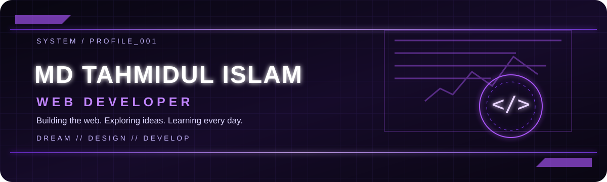
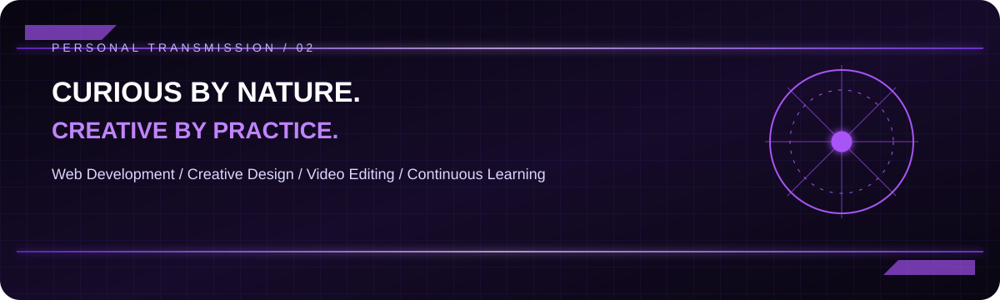
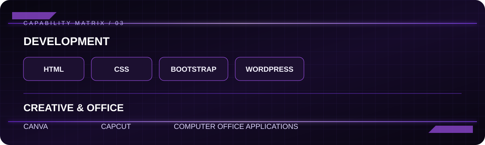
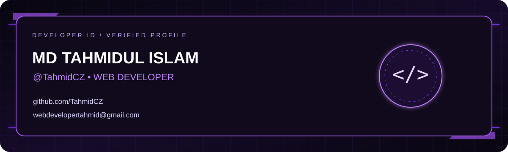

---

## ◈ About Me

Hi, I'm **MD Tahmidul Islam** — a **Web Developer** who enjoys building for the web, exploring creative tools, and continuously learning.

- Focus: Web Development
- Creative interests: Design and Video Editing
- Learning mindset: Continuous improvement

## ◈ Tech Stack

**Development**
- HTML
- CSS
- Bootstrap
- WordPress

**Creative & Office**
- Canva
- CapCut
- Computer Office Applications

## ◈ Projects

> **Project showcase is coming soon.**  
> Project links will be added here when public repositories are available.

## ◈ GitHub Statistics

*Statistics and activity graphics are supplied by their respective services and may take time to update. No contribution totals or achievements are manually claimed here.*

## ◈ Contributions

Decorative artwork only — it does not represent actual GitHub contribution data.

## ◈ Connect With Me

**Let's build something meaningful.**

